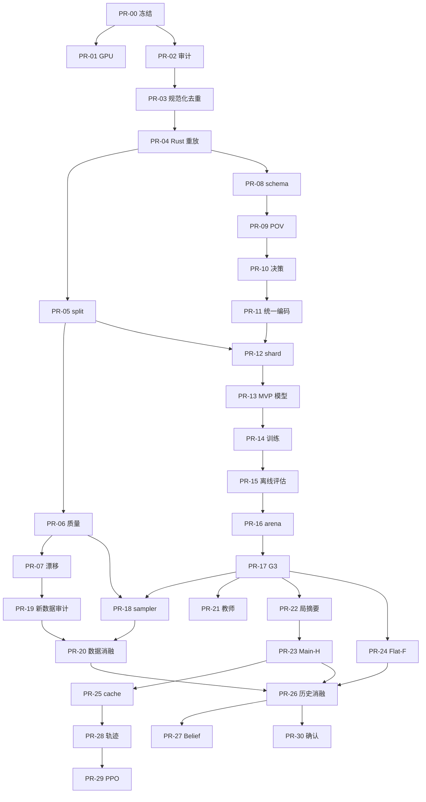

# RiichiFormer V2 — 逐 PR 开发卡片（逐步执行说明）

**使用方式**：Agent 每次只领取**一张卡**，不得跳过 `depends_on`，不得因为某项“看上去简单”略过测试。下面所有 `rf_*` 命令均是**未来应实现的 CLI**，现有仓库不具备这些命令。每张卡的 `PASS` 指设计的验收条件，不代表本文档作者执行过。

## Phase 0 — 冻结环境与基线

### PR-00 | 原始基线冻结、独立分支、保护机制

**depends_on**: none · **produces**: G0 的前半。

**文件**：`.gitignore`（追加）、`docs/riichiformer/BASELINE_LOCK.md`、`scripts/rf_preflight.py`、`tests/rf_test_preflight.py`。

**Agent 的具体步骤**：

1. `git status --porcelain`, `git rev-parse HEAD`, `git submodule status`, `find checkpoints -maxdepth 1 -type f`；确认运行目录是 `ygmldr/riichi-ai`。本地不存在 checkpoint 时，写 `UNAVAILABLE`，不要创建假的权重。
2. 记录 `vendor/mortal` SHA、现有 `patches/0001..0013` 的 SHA-256、旧 `configs/config.toml` 的 SHA、`scripts/eval_report.py` SHA；把它们写入 `BASELINE_LOCK.md`。
3. 如存在 `checkpoints/mortal.pth`、`best.pth`、pin baseline、`grp.pth`，写 hash 和模型实际可读状态；不存在的记录 `NOT_FOUND`。
4. 把已有评测 seed-key、已消费窗口及独立确认窗口整理成 `docs/riichiformer/EVAL_POOL_REGISTRY.md`。注意 A14 `[70000,73000)` 已用于确认，**不能再宣称 virgin**。
5. 写 `rf_preflight.py`：只读检查 Python/PyTorch/Rust/CUDA + baseline files，不自动下载、不安装、不跑训练。
6. 在 `.gitignore` 加入 `artifacts/riichiformer/`、`datasets/`、`checkpoints/`、私有账户映射、`*.key`；检查 `git status` 不包含数据和权重。

**测试**：

```bash
python3 scripts/rf_preflight.py --output artifacts/riichiformer/preflight.json
python3 -m pytest -q tests/rf_test_preflight.py
python3 -m compileall -q scripts/rf_preflight.py
```

`preflight.json` 必须包含 `status`, `git_sha`, `submodule_sha`, `torch`, `cuda`, `gpu_name`, `vram`, `git_dirty`, `baseline_paths`, `warnings`。检查程序遇到缺文件应 `WARN/BLOCKED`，**不能通过偷偷生成 baseline.pth 获得 PASS**。

**PASS**：记录可复现，旧文件内容不变，初始评测注册可核查；有缺失时报告 blockers 而非训练。

---

### PR-01 | 依赖/设备基准与存储规划

**depends_on**: PR-00。

**文件**：`scripts/rf_bench.py`、`configs/riichiformer/benchmark.yaml`、`docs/riichiformer/GPU_ENV.md`、`tests/rf_test_bench.py`。

**步骤**：

1. 读取真实 GPU UUID/VRAM/driver, torch CUDA 版本, BF16 支持；验证 `torch.cuda.is_available()`，仅在 CUDA 可用时做 GPU 测试。
2. 建立一个 PyTorch SDPA synthetic benchmark（与麻将数据解耦），依次尝试 `(B,L,d)=(8,512,256),(4,1024,384),(2,2048,384),(1,4096,384)`；依次做 warmup 10、测量 30 个 step，OOM 逐配置 `record and continue`，不能把失败记为 0 ms。
3. 开启 BF16 autocast，记录 forward、forward+backward、optimizer step，输出 `torch.cuda.max_memory_allocated/reserved` 和 tokens/s；每组测前 `reset_peak_memory_stats`。
4. 统计本地 zip、解压、shard 和 checkpoint 的可用磁盘预算；不要删任何 zip。
5. 写 WSL/Windows 下 dataloader 的 spawn 与路径注意事项；尽可能固定依赖版本（Torch 官方 wheel，不能把 `torch.compile` 设为强依赖）。

**运行**：`python3 scripts/rf_bench.py --config configs/riichiformer/benchmark.yaml --out artifacts/riichiformer/bench/gpu_baseline.json`

**PASS**：至少一个 GPU 训练 shape 通过；每个失败 shape 有错误与显存记录；没有偷偷改 GPU 设置或后台任务。

---

## Phase 1 — 数据目录、来源、合规与质量报告

### PR-02 | 原始年度文件审计（只读）

**depends_on**: PR-00。

**文件**：`riichiformer/data/scan.py`、`riichiformer/schemas/provenance.py`、`scripts/rf_data_audit.py`、`tests/rf_test_scan.py`。

**步骤**：

1. 参数 `--roots` 接受本地目录/zip（默认不下载）；扫描 `2009..2026`，文件名/大小/mtime/source URI/年度汇总。
2. 检测文件头 magic `1f 8b` 是 gzip，`PK` 是 zip，`{` / JSON 文本是明文；**不要以 `.mjson` 扩展名判断压缩**。两种压缩同名要记录哈希并正确解码。
3. 对每个 zip 先验证 ZIP central directory/CRC；记录每年 `game_logs`，抽样解析 MJAI，统计事件类型和 `start_kyoku` 次数。不要把 `.mjson` 文件数写成“局数”。
4. 读取来源元信息（若本地含 yearly DB 则解析并记录表名/列名，不假设段位、R 一定存在）。所有无法证明的来源信息填 `unknown`。
5. `source_rights.csv` 逐来源记录官方条款 URL、许可状态、权利范围、复核日期。`unknown/restricted` 不进入**新训练数据**；既有训练可复现实验需分开记录现有来源风险，不擅自据此推定许可证合法。
6. 输出 `DATA_REPORT.md` 和机器可读 `source_audit.parquet`、`yearly_counts.csv`、`bad_files.jsonl`；敏感原始名称只保留本地私有 sidecar。

**命令**：

```bash
python3 scripts/rf_data_audit.py --roots datasets/ --mode scan-only \
  --out artifacts/riichiformer/audit
python3 -m pytest -q tests/rf_test_scan.py
```

**测试样例**：gzip `.mjson`、明文 `.mjson`、损坏 gzip、损坏 zip、`.mjson.gz`、混合根目录、重复文件名、空目录；`empty` 报告应成功但阻止训练。

**PASS**：每一年覆盖范围和 compression 统计有真实数字；每个发现的文件有来源，审计无网络、无数据改写、无身份推断。

---

### PR-03 | 规范化事件与去重

**depends_on**: PR-02。

**文件**：`riichiformer/data/canonicalize.py`、`riichiformer/data/dedup.py`、`tests/rf_test_canonicalize.py`。

**步骤**：

1. 每场 decode gzip/明文 → NDJSON，严格逐行 `json.loads`；保留原始事件顺序，拒绝无 `start_game/end_game`、不成对的 `start_kyoku/end_kyoku`。
2. 从原始标准字段产生规范化 Unicode/JSON（稳定 key-order/数值表示），只做无损规范；**不能重新计算被遗漏的隐藏摸牌、杠宝牌、未来结果**。
3. 计算 `original_sha256`（原始字节）、`canonical_sha256`（事件规范字符串 SHA）；若有原始 Tenhou log ID，则另生成 `platform_game_key`。
4. 去重优先 `platform_game_key`，再 canonical hash，冲突时记录 `hash_collision_review`，同源不同格式要留 provenance 多值但**保留一份训练对局**。
5. 输出审计表 `canonical_log_index.parquet`：`game_id,source,sha,canonical_sha,year,compression,events,kyoku_count,duplicate_group,invalid_reason`。
6. 用固定 `sample --seed 20261121 --strata year/source` 跑 1000 场人工可抽查列表。

**验收**：相同 NDJSON 转 gzip / 明文 hash 不变；变一个公开事件 hash 改变；文件名字不同的转换副本识别为重复；不存在静默修复逻辑。

---

### PR-04 | 规则重放验证与决策统计

**depends_on**: PR-03。

**文件**：`riichiformer/data/replay.py`（Rust/PyO3 wrapper）、`tests/rf_test_replay.py`、`scripts/rf_validate_replays.py`。

**步骤**：

1. 实查固定 submodule 中 `GameplayLoader::load_log`、`GameplayLoader::load_events_by_player` 和 `PlayerState::update`；明确原生输出 shapes、行动 ids 和 `can_act` 行为。
2. 创建只读 `ReplayAdapter` API：`replay_game(raw_events)->(per_seat decision_refs,legal_masks,actions,kyoku_starts,final_scores)`。内置 Rust state，避免在 Python 复制规则。
3. 将原始 `Gameplay` 的每一 action/mask 作为一致性基线（标签源）；若 player state 更新结果与其不一致，用 fixture 定位，而不是根据动作猜索引。
4. 对全量先 1000 场分层 smoke，再跑全量流式验证；失败输出 `invalid_games.jsonl`（含具体 event index、错误类型、source）和分母。
5. 只以**游戏**为单位决定是否可被训练；若某局有可挽救且已解释的非决策异常，可另建严格白名单并记录，不默认修复。
6. 枚举稀有情形：吃碰杠后反应、抢杠、两家同时荣和、立直受理、流局、同点排序、赤 5、南四连庄。用至少 1 个真实/构造 fixture 测每类。

**命令**：`python3 scripts/rf_validate_replays.py --manifest ... --out artifacts/riichiformer/replay --workers 4`

**PASS**：随机分层 1000 场无未解释 mask/action mismatch；全量报告合法率与错误类别；所有监督动作合法，遇到失败拒绝样本不糊弄。

---

### PR-05 | 冻结数据 split、权益与重复隔离

**depends_on**: PR-03, PR-04。

**文件**：`riichiformer/data/split.py`、`docs/riichiformer/SPLIT_REGISTRY.md`、`tests/rf_test_split.py`。

**步骤**：

1. 决定 `Protocol L` 和 `Protocol R`；先基于实际年度时间戳能力选 `calendar` 或 `hash_fallback`（后者必须明显标注不是时间外）。
2. 全 `game_id` 分组 split；同一场牌谱的四视角、不同转换副本和所有 per-event 标签不能跨分区。
3. 检测重复原始 ID、SHA、相同 seed/wall 的跨分区冲突。只有 `split_registry_hash` 固定后才能启动真实训练。
4. 对之前 EX1 消费过的 2024–2026 牌谱标记 `previously_used_in_research=true/unknown`；若没有完整名单，不能声称整个年份是 virgin。
5. 新建 `split_manifest_{L,R}.parquet` 与 `SPLIT_REGISTRY.md`，同时保留 `blocked_source`、`undated`、`holdout` 状态，不自动扔到 train。
6. 实现 `--assert-no-overlap` CLI；每次 shard 构建和 checkpoint 加载都检查对应的 split hash。

**测试**：同一 game 的 4 POV 在同 split；重复目录路径不会重复采样；显式时间边界严格；hash seed 改变会要求新 `split_version`；不支持的时间信息 fail closed。

**PASS**：train/val/select/confirm 的 SHA 集互斥；`confirmed_new` 与 `previously_used` 清楚分开；有权利问题的来源不会混入允许训练名单。

---

### PR-06 | 玩家元数据与质量评分

**depends_on**: PR-05。

**文件**：`riichiformer/data/player_quality.py`、`scripts/rf_quality.py`、`tests/rf_test_quality.py`。

**步骤**：

1. 如果有可信的年度原始数据库/账号公开统计，先检查时间、R/段位、采集合法性。字段不存在就记录 `null`，不从 `names` 推断段位。
2. 从 `names` 生成**本地 HMAC** 账户键；没有 `RF_PLAYER_HMAC_KEY` 则生成不了 player-linked audit，但仍可按游戏独立做基础数据审计。原名和盐绝不写入公开 artifact。
3. 按 `(player_id, match_time)` 排序，计算该 match 之前的独立多场分数、平均顺位、含场次数的经验贝叶斯缩减 `q=(n*mean + 100*prior)/(n+100)`；`prior` 与 `k=100` 写 config，并视为候选。`n<50` 标 `insufficient_history`。
4. 不用目标对局自身结果或验证/测试对局来评分自己的标签。缺日期时不可算时间前缀实力，退回全量池。
5. 预定义 `TOP25_SEATS` 为对**达标玩家的 seat-game 决策**重加权，不能把同场另外三个座位自动标成高手。
6. 生成可靠性报告：独立未来场次里质量分位数 vs 顺位、场景、教师 regret（如有）；数量稀少分位不能定性为高质量。
7. 输出 `quality_scores.parquet`（HMAC-only）和 `quality_audit.md`，记录每组独立玩家/独立场次数、时间覆盖和 source breakdown。

**测试**：把玩家在目标赛局后的 100 场成绩全部改掉，目标赛局评分不变；单场冠军不自动获得高质量标记；HMAC key 缺失不落原名日志；仅有 1 场记录不会给满置信分。

**PASS**：训练分区之外的结果不会影响训练质量分；有数值报告和置信程度，没有 AI 账号猜测。

---

### PR-07 | 年代漂移、平台/规则差异研究

**depends_on**: PR-05, PR-06。

**文件**：`riichiformer/data/drift.py`、`scripts/rf_drift.py`、`docs/riichiformer/DRIFT_REPORT.md`。

**步骤**：

1. 年/月汇总基础指标：真实对局数、独立玩家数、局数、决策数，len p50/p90/p99/p999、行动频率、场风、亲家、点数分布。
2. 对 `riichi_rate`、开鸣率、立直对抗押牌率、all-last 行动、平均打点、放铳等建立**条件分层**（局况/分差/巡目/规则），不能直接比较未校正原始比例就当水平变化。
3. 使用 2019–2022 vs 2023–2024 vs 2025 vs 可核验 2026 的时间窗；2026 缺月份要标缺失，无充分样本则不下结论。
4. 若有本地已授权教师，可只做**有限审计抽样**：分层地比较教师与人类动作一致、top2 gap、严重 regret；结果只证明风格差异，不当真值。
5. 公开确证 AI 牌谱存在时允许 `confirmed_ai` 独立 cohort；没有证据所有其他牌谱为 `unknown` 而非 `confirmed_human`。
6. 输出 `drift_cohorts.csv`, `drift_report.md`, 置信区间和 source caveats。

**PASS**：所有数字有分母、时间窗和来源，明确哪些现象是频率差异、哪些能够支持质量差异；不发布未经证实的违规玩家名单。

---

## Phase 2 — 可见信息、序列与在线一致性（必须先于训练）

### PR-08 | Frozen V2 schema 与动作映射

**depends_on**: PR-00, PR-04。

**文件**：`riichiformer/schemas/event_v2.py`、`riichiformer/schemas/dataset_v2.py`、`docs/riichiformer/FEATURE_SCHEMA_V2.md`、`tests/rf_test_schema.py`。

**步骤**：

1. 枚举原始 Rust `Event` 全部 15+ 类分支，在 feature spec 写 `public/private/terminal` 字段对照。
2. 固定 `TileKind=0..33, SENTINEL=34`，赤 5 分别独立 flags；Actor relative 0..4。
3. 固定 event fields、默认值、dtype、normalizer、序列 position、决策快照 schema、action 46 mapping。建议通过文件 JSON SHA hash 生成版本码，不允许自动变动。
4. `ActionMapping` 显式从现有 Rust / Python binding 提取 index/对应含义，通过 fixture 验证 46 项和 legal mask 一致；不自行推测所有特殊行动 index。
5. schema loader 若 `schema_version`, `action_map_hash`, `normalizer_hash` 不匹配直接异常。

**PASS**：至少每类 event 一个 fixture，通过 schema roundtrip；已有 action index 不变；文档标明各字段信息可见时机。

---

### PR-09 | POV 隐藏信息投影器

**depends_on**: PR-08。

**文件**：`riichiformer/data/pov.py`、`tests/rf_test_pov.py`。

**步骤**：

1. 实现 `project_event(raw_event,pov,visibility_context)->ObservableEventV2`，使用**显式 allowlist**构造新 dict；不要简单 `copy.deepcopy(raw_event)` 再弹出几项。
2. `StartKyoku`: 仅拷公共字段 + `tehais[pov]`（进 `OWN_HAIPAI` 专属 token）；另外三家的手牌不得进入输出内存结构/序列化对象。
3. `Tsumo`: `actor==pov` 保留 tile/aka；否则只留 actor、type、事件序号、允许的巡目计数；`pai=34`,`aka=false`。
4. `Dahai,Chi,Pon,Kan,Dora,Reach`：按平台真正公开信息生成；暗杠、杠宝牌翻出时机单列 fixture。没有证据可见的字段不要使用。
5. 终局 `Hora/Ryukyoku` 只有在事件发生后可见，必须只追加到 stream 后部。
6. 写 property-based tests：生成同 public action prefix、不同 opponent hidden tiles 的两种原始输入，项目输出必须**byte-equal**；该测试不依赖物理完整墙可重放。
7. 输出 scan 工具可以检查所有模型输入 field 路径，检测含 `seed, names, opponent_tehai, next_action, uradora_future` 等 forbidden keys。

**核心断言**：`encode_pov(change_opponent_draws(raw),pov)==encode_pov(raw,pov)`（只在公共前缀相同的范围内）；自摸替换必须使自家 POV 输入改变；非自己 POV 自摸不可隐藏。

**PASS**：所有测试通过，输入类型中完全没有可读取隐藏牌的字段；出现未知 event 类型**报错**而不是 fallthrough raw dict。

---

### PR-10 | PlayerState 决策快照和 censored 反应

**depends_on**: PR-04, PR-08, PR-09。

**文件**：`riichiformer/data/decision.py`、`tests/rf_test_decision.py`。

**步骤**：

1. 对每个 game/Pov 建立原生 `PlayerState::new(pov)`；按原始事件推进状态机。这个状态对象内部可能处理全原始事件以维护游戏物理状态，但**对神经网络投影只抽取 POV 可见特征**。严格检查 state getter 对 opponent private 的访问。
2. 当 `cans.can_act()` 成立，**先**建立决策快照和 46 位 mask，再将 `DECISION` token 插入 visible stream；将真正执行的动作从后续可确定事件映射成 `action_id` 存到 labels 中。
3. 对 MJAI reaction window 的顺序/被抢断情况，优先和 `GameplayLoader.extend_from_event_window()` 的结果对齐；无法确认 PASS 的 `supervision_valid=false,censor_reason=preempted_or_ambiguous`，绝不硬编 PASS。
4. 每个 snapshot 保存 `event_prefix_end,kyoku_idx,relative_pov,legal_mask,hand_count/scores/visible_dora`，校验和独立 `PlayerState` 的观测字段对应。
5. 对 1000 场完整可重放游戏比较有效 label 数、动作 id、mask、对应事件 index；差异写逐条 report，不以“多数正确”通过。
6. 对能赢牌时 `hora`/`ron`、立直、吃碰杠、加杠、自摸、流局、赤 5 特别检查 action mapping。

**PASS**：所有 `supervision_valid` 样本有合法 mask、存在 label 且 label 属于 legal；与基线有不一致须解释并增加回归 fixture。对无法对齐样本**不进入训练**且报告数量。

---

### PR-11 | offline encoder 与 online encoder 的统一实现

**depends_on**: PR-09, PR-10。

**文件**：`riichiformer/data/encode.py`、`riichiformer/arena/audit.py`、`tests/rf_test_parity.py`。

**步骤**：

1. 建立唯一纯函数 `encode_observation(events_visible,decision_snapshot,schema)`，离线 shard 与在线 bot 均调用；不分别实现两种 encoder。
2. 模型 token 字段至少为 `type, actor, target, tile, flags, consumed_ids[4], public_feature, private_hand[37], is_decision`；每类缺失字段用固定 sentinel/mask，而不是 Python `None` 混叠。
3. 不在所有 event token 重复大幅 37 维手牌向量；只在 `OWN_HAIPAI` 或 `DECISION` 注入。分数等公共局况按 schema 指定时机注入。
4. 从同一段合法牌谱同时走 `offline replay + visible projection` 与 `online event callback + state`，逐 decision 比较所有 tensor bitwise；若浮点正常化导致非逐位可复现，先比规范输入定点值，再用 `allclose` 验证 float。
5. 测试序列跨局状态：上一局 `END_KYOKU` 和下一局 `START_KYOKU` 之间没有同局 future leakage。

**命令**：`python3 -m pytest -q tests/rf_test_parity.py -vv`

**PASS**：至少 100 场真实合法牌谱的 4 POV + 上述稀有事件 fixture 全部对齐（零未解释差异）；训练与在线调用同一个 encoder 版本。

---

### PR-12 | 完整半庄 shard + 高效 dataloader

**depends_on**: PR-05, PR-11。

**文件**：`riichiformer/data/shard.py`、`riichiformer/data/collate.py`、`riichiformer/data/sampler.py`、`scripts/rf_build_shards.py`、`tests/rf_test_shard.py`。

**步骤**：

1. 采用 `(game_id,pov)` 作为最小存储单元；内部存每局的变长可见事件、决策快照的**稀疏位置与 labels**、已完成局 summary 边界。不要把每一决策的历史前缀复制多次。
2. shard 格式可用 Arrow IPC / parquet + mmap offsets 或 msgpack/zstd；先在 pilot 1000 场验证零拷贝/随机读性能，再冻结实际格式。**保存 schema/action/split/source hash**。
3. 一条 shard 必须可从原始 canonical MJAI 重建；每条 `decision_id` 唯一、不可漏/重。
4. 保存压缩后 4 POV 与原始数据对应；确保每游戏四座位在同 split，loader 能按 `game_id` 统计 group。
5. Collate：按局长分桶，构造 `(B,L)` 有效长度+决策 mask+46 legal；attention mask 既不能看未来也不能看 padding；为 SDPA 做严格单测。
6. DataLoader worker 要有独立 seed + resume 指针；中断恢复时不能默默改变抽样顺序；记录 sampler epoch/sample id。
7. 新 CLI `--scan-lengths --histogram` 输出 `kyoku_event_length` 和 `full_hanchan_event_length` p50/p90/p99/p999/max，`censored_count/coverage`。

**命令**：

```bash
python3 scripts/rf_build_shards.py --split-registry docs/riichiformer/SPLIT_REGISTRY.md \
 --manifest artifacts/riichiformer/manifest/v2.parquet \
 --limit-games 1000 --out artifacts/riichiformer/shards/pilot
python3 -m pytest -q tests/rf_test_shard.py
```

**PASS**：shard round-trip 完整；标签数对齐 replay；合法 mask 无异常；无静默截断；报告实际长度分布；磁盘成本被计量。

---
## Phase 3 — MVP 小模型 + 单卡监督训练（先过 G3）

### PR-13 | `LocalTransformer-S` 实现

**depends_on**: PR-08, PR-12。

**文件**：`riichiformer/models/common.py`、`models/local.py`、`models/heads.py`、`tests/rf_test_model.py`。

**实现步骤**：

1. 用原型 `RiichiFormer-S-v0.1` 的 tensor shape 作为参考，不复制其 12 层配置；建立自己的 `LocalConfig` (`d=256, heads=4, layers=6, ffn=768`) 和严格 Config validator。
2. 实现字段独立的离散 embedding（`type, actor, target, tile, flags, consumed[4]`）和公共数字特征、仅自家的私有手牌 state MLP；缺失值 sentinel 固定。
3. 注意力为 causal decoder block（RMSNorm → SDPA(Q,K,V,causal) → residual → SwiGLU → residual）；RoPE 在 Q/K 中施加，按单局起始序列位置归零；确定 `is_causal` 与 key-padding 的 mask 合成方式，在实际 SDPA API 下做等价测试。
4. 输出所有 `decision_mask` 位置的 46 logits；先在 head 前检验非空 legal mask。`masked_fill(~legal_mask, -inf)` 后 eval `argmax` 必在 legal 内。
5. 不把 `rank_targets/tenpai_targets/played_action` 作为 feature; `model.forward()` 仅接收 `ObservationBatch`，labels 由损失函数独立处理。
6. 返回 shape：`[num_decisions,46]`、`locations`、可选中间激活。保存模型 `parameter_count()` 并测确切规模。

**测试**：

```text
- 模拟输入 (B=2,L=64) → N_decisions 个 46 logits
- 只有 1 个合法行动时其概率为 1
- 前后 padding 变化有效输出相同（严格时间位置要求）
- 更改未来 token 时早期 decision 输出不变
- 所有参数有预期梯度；BC 可以在 16–128 个人工样本过拟合到 >99% (sanity)
- 错误 45/47 位 legal mask 或越界 token 必须抛明确异常
```

**PASS**：CPU forward/backward/all tests 通过；GPU BF16 通过；若 `torch.compile` 关闭依然可用；输出参数真实值不强迫落入预估 5–8M 区间。

---

### PR-14 | BC 损失、训练器、可恢复 checkpoint

**depends_on**: PR-13。

**文件**：`riichiformer/train/losses.py`、`train/trainer.py`、`train/checkpoint.py`、`scripts/rf_train.py`、`configs/riichiformer/mvp_s.yaml`、`tests/rf_test_train.py`。

**实现步骤**：

1. `rf_train --config --data-split --max-steps --out` 以**只读** shard 集合进行随机 minibatch 训练，训练日志每 N 步包括 `loss,BC_NLL,accuracy,nonpad_tokens,labeled_decisions,unique_games_seen,lr,grad_norm`。
2. MVP 初始 `loss=BC_CE`，mask 无效或 censored 的位置全部排除；对每个 `(game_id,pov)` 先算 decision 平均，再聚合到 batch，避免长局占优；提供 `loss_normalization=per_decision` 消融但不偷偷切换。
3. AdamW（初始候选 `lr=3e-4, weight_decay=0.1`），warmup 约前 2% steps，之后 cosine；需要真正预注册并记录 scheduler；`clip_grad_norm_=1.0`，BF16 autocast，grad accumulation。注意这些只是起点，不是论文认可的最优值。
4. 按**固定样本 ID**运行 deterministic loader；保存 optimizer、scheduler、RNG（Python/NumPy/Torch/CUDA）、sampler cursor、config、git SHA、source/split/schema hashes；中断续训 checksum 一致。
5. 验证集完全 eval 模式 no_grad，不读取测试/confirm；每次 validation 同 shard / fixed sample IDs；保留 `best_by_val_nll` 和 `latest_step` 两个 checkpoint，不能以 test rank 选最优。
6. 每隔 100 step 检查 NaN/Inf、illegal-mass、empty-decision、OOM（abort+保存运行状态，减 batch 要有新 run id）。
7. 从小数据 64 samples overfit → 1000 games pilot → 10k+ games formal，训练数据大小进 config，禁止大数据启动没有 smoke。

**验收命令**：

```bash
python3 scripts/rf_train.py --config configs/riichiformer/mvp_s.yaml \
  --data-split train --limit-games 1000 --max-steps 100 --out artifacts/riichiformer/runs/mvp-smoke
python3 -m pytest -q tests/rf_test_train.py
```

**PASS**：损失在小样本可明显下降；断点重启相同数据顺序/模型权重在 CPU deterministic 模式下可复算；GPU 记录实际显存；无 NaN；不能只凭训练 loss 宣称“麻将强度”。

---

### PR-15 | 离线策略评估与类别诊断

**depends_on**: PR-14。

**文件**：`riichiformer/eval/offline.py`、`eval/strata.py`、`scripts/rf_eval.py`、`tests/rf_test_offline_eval.py`。

**实现步骤**：

1. 固定 manifest split 与 checkpoint hash，评估 `BC_NLL,non-forced top1/top3 agreement,illegal action rate`；按 `decision_kind,kyoku,early/mid/late,riichi_on_table,score_gap,turn_count,era` 分层。
2. 统计样本真实来源、有效决策数、censored 比例、被过滤样本；不能只报告一个 accuracy。
3. 把教师一致率定义为**教师风格匹配**而非策略强度；若 teacher Q 不含概率校准，不直接输出 cross entropy 真值。
4. 输出 `offline_eval.json/csv` + 所有分层（包括样本量极少、CI 很宽的）+ 资源开销。
5. 增加 deterministic smoke 测试：同一个 checkpoint/seed/split 重复两次输出逐项一致。

**PASS**：可复现的 held-out 报告；所有分层携带分母；训练/确认集不混用。

---

### PR-16 | 与 libriichi arena 对接，完成本地实战

**depends_on**: PR-11, PR-13, PR-15。

**文件**：`riichiformer/arena/adapter.py`、必要的自有 Rust patch、`tests/rf_test_arena.py`、`scripts/rf_arena_smoke.py`。

**实现步骤**：

1. 阅读真实的 `vendor/mortal/mortal/one_vs_three.py`、`libriichi/src/arena/one_vs_three.rs`、`libriichi/src/agent/*`；识别支持的 engine protocol（`start_game`, `react_batch`, `end_kyoku`, `end_game`、name/seat）与可传递的事件。
2. 实现 `RiichiFormerEngine` 自己的 per-game/per-seat runtime state；每次接到 MJAI 事件先 POV 投影更新 event stream、PlayerState，再在需要决策时使用**与离线完全一致**的 encoder 和 46 action mask。
3. 将 action_id 转回 libros engine 需要的 MJAI action JSON；不能只返回 index（若协议要求 JSON）；复用现有 native action encoder/decoder 的行为和特殊动作规则。
4. 初版为正确性允许完整 prefix forward；只要局内完整历史和结果一致，效率后置。记录每决策延迟分布。
5. 完成 `start_game` 清空旧缓存、`end_kyoku` 更新分数/局况（跨局记忆尚未启用）、`end_game` 回收状态；支持同批不同 game 交错。
6. 在 fixture 对照模式下，用同一个历史决策前缀跑离线/在线模型：logits 对齐在浮点容差内，argmax 合法完全一致。
7. 使用现有 `scripts/eval_report.py` 解析 duplicate NDJSON；**不改其计分语义**。如果现有 Python engine 不兼容，要写明扩展接口并加自有 patch，绝不向旧 one_vs_three 注入半成品模型。

**命令**：

```bash
python3 scripts/rf_arena_smoke.py --checkpoint artifacts/riichiformer/runs/mvp-smoke/best.pt \
  --games 16 --out artifacts/riichiformer/eval/arena-smoke
python3 -m pytest -q tests/rf_test_arena.py
```

**PASS**：16 场 4 席轮转无非法动作、无 runtime 断言、无状态跨 game 污染；记录每场实际 logits/动作 trace（不含隐藏输入）。如还不能接入正式 1v3，则状态为 `BLOCKED`，不可称 G3 通过。

---

### PR-17 | G3 冻结与设备基准报告

**depends_on**: PR-14..16。

**文件**：`docs/riichiformer/G3_VERDICT.md`、`docs/riichiformer/MVP_MODEL_CARD.md`、`artifacts/riichiformer/bench/*`。

**步骤**：

1. 重跑数据、schema、POV、arena parity、训练恢复所有测试；记录 5070 Ti 实测峰值 VRAM、train decisions/s、eval p50/p95。
2. 用固定独立验证集比较 random legal/mode baseline、已有原 Mortal 预测（如许可允许），并输出局面分类指标。大模型训练预算根据真实速度设置。
3. 必须给出 `GO/NO-GO`；若 `NO-GO`，只修失败环节，不能直接扩模型。
4. G3 PASS 并不要求达到 Mortal 强度，只要求正确学习、合法打牌和完整可重现实验。

**PASS**：所有依赖测试确实执行并通过；MVP 训练和 arena smoke 证据齐全；GPU/CPU 吞吐、峰值显存、局面诊断全部有真实数据；冻结 MVP 模型卡并只在此后进入数据与结构消融。

---

## Phase 4 — 质量筛选、年代补充与 AI 教师数据

### PR-18 | 实现分层数据采样器

**depends_on**: PR-06, PR-07, PR-17。

**文件**：`riichiformer/data/sampler.py`、`configs/riichiformer/data_ablations.yaml`、`tests/rf_test_sampler.py`。

**步骤**：

1. 基于**seat-game** 的 `quality_score`、`era`、`scene` 建可重现 strata；同一游戏内其他座位仍作为环境历史，但其动作不能被误标成 top-quality supervised target。
2. 支持 `D0_ALL`, `D1_TOP25_SEATS`, `D2_MIX_60_25_15`, `D3_RECENT`；每个 sampler 输出实际抽取的 game_ids/seat_ids、重复次数、训练决策数、有效 token 数。
3. `D1` 只在可信质量分存在、场次数过门槛的用户群上执行；质量标签缺失时 D1 有效样本不足需要声明并退出，而不是把 unknown 当低质量。
4. **对照强制等有效 label decisions + optimizer updates**；另做 equal-unique subset / equal-token 对照。所有配方出采样 manifest SHA。
5. 防止简单近期权重导致极少月份被重复上百次；设置 `max_repeat_per_seat_game`（候选先 4），超过则报告并停止该 arm。

**测试**：固定 seed 顺序一致，重复抽样计数正确，四座位 split 不跨，质量来源仅限训练分区，预设重复上限触发明确失败。

**PASS**：对每一种 arm 可以完整复现抽样结果、计数和 SHA，且不存在从未来评价集构造玩家质量或超额重复采样。

---

### PR-19 | 近期数据审计与合规补充（仅在条件满足时）

**depends_on**: PR-02..07, PR-18。

**文件**：`docs/riichiformer/RECENT_SOURCE_REPORT.md`、`artifacts/riichiformer/manifest/recent_*`。

**步骤**：

1. 先列出**本地已持有** 2023/24/25/26 年数据日期覆盖与缺口；明确当前第三方 README 的 2026 仅 1 月档案信息不代表 11 月已完整。
2. 查证各来源许可与合法可用的获取途径，核对 ruleset、原始 date、account metadata、possible_AI 标注的可靠来源。**不执行绕过禁令的爬取或在线挂机**。
3. 只有有权且允许目的用途的渠道进入新数据获取；下载/转换时逐档案 checksum、来源日志、版本、重复检测；禁止从不完整转换猜测未知宝牌/墙。
4. 转换新数据后跑 PR-03/04/05/09/11 全量检查；和旧年度同一规则集才能进相同训练 arm，否则独立跨平台研究。
5. 按月写 `coverage_heatmap.csv`：实际场次数、可用牌谱局数、独立玩家数、是否补齐、2026 日期上界。
6. 如果未找到具备使用许可的补充来源，`BLOCKED_RECENT_DATA` 但**继续用已有合法数据**推进 D0/D1；不可编造 AI 数据收集结论。

**PASS**：每个新增记录都有合法来源说明、日期、sha、规则、去重、重放；无法满足则明确 blocked。

---

### PR-20 | 独立数据配方消融（同模型、同预算）

**depends_on**: PR-17..19（PR-19 可 BLOCKED，但不影响 D0/D1）。

**文件**：`docs/riichiformer/ABLATION_REGISTRY.md`、`configs/riichiformer/ablations.yaml`、`scripts/rf_run_data_ablations.py`。

**步骤**：

1. 预注册 `D0 vs D1` 为第一主比较，`D0 vs D2/D3` 为次比较；固定 MVP-S、train seed（至少 2 个独立模型 seed 才能评价训练随机性）、模型参数、优化步数和 labeled decisions 预算。
2. 从小等预算 pilot 验证训练吞吐和 loss 稳定，做 D0/D1 正式；若 D1 质量数据少，做等 unique seat-game vs D0 附加控制。
3. 验证时间外 NLL 与分层攻守指标，再在本地 1v3 duplicate 先 2k/4k 排故→12k/24k 选择；使用相同墙和 seat rotations 计算**配对差值**。
4. 选择 pool 仅用于选择，最终确认另预留先前未消费的墙种子，按 game-set bootstrap；不把已消费的 `[70000,73000)` 再称未见。
5. 不能因为 12k 点估计更好就宣布 `Top25` 有效；报告 CI 与功效不足。小样本不显著时结论是 inconclusive。
6. 记录：训练样本数/unique/再采样率、每类决策、GPU 小时、checkpoint hashes、arena 结果、置信区间和异常。

**PASS**：数据配方唯一变化，结果既有预测指标又有真正对局强度；明确赢家/平手/证据不足/不值得继续。

---

### PR-21 | 本地教师标注和单轴蒸馏

**depends_on**: PR-15, PR-17；`D0/D1` 完成有利但可并行标注。

**文件**：`riichiformer/train/distill.py`、`scripts/rf_distill.py`、`tests/rf_test_distill.py`。

**步骤**：

1. 审核老师 checkpoint 的许可与使用条件；固定现有 Mortal 模型 SHA 和动作 mapping/snapshot adapter。
2. 在**事先固定**的训练 decision IDs 子集上批量推理 `teacher_Q[46],teacher_mask,teacher_argmax,teacher_version`，保留原 human action；不将教师反推其他人的私有牌。
3. 教师输入必须是当前 POV 的原生 Mortal 观测，决策 id 和 legal mask 与新 V2 相同；不允许对部分 mismatched 决策猜 Q 序号。
4. 软标签 `p_T=softmax(Q_valid/T)` 并标注温度；`T={0.5,1,2}`、`alpha_KL={0,0.25,0.5}` 为**候选实验**。先测极端 Q scale/数值稳定、等 Q 标签退化为均匀分布。
5. 单独蒸馏 arm 不修改训练 data schedule，控制同总梯度预算、unique supervised decision IDs；teacher Q 来自旧模型，不等于真实价值，输出 agreement 但只以 arena 真正强度决策。
6. 若老师/学生动作空间定义不兼容，`BLOCKED` 并增加 mapping fixture，不得按位置硬对齐。

**PASS**：1000 fixture label 对齐、全部 soft targets 归一化且 masked invalid 概率为 0；teacher metadata hash 完整，消融包含 `alpha=0` baseline。

---
## Phase 5 — 跨局记忆和完整历史架构（G5）

### PR-22 | 生成可学习的「完成局摘要」

**depends_on**: PR-17；数据配方 D* 已决定后更合适。

**文件**：`riichiformer/models/memory.py`、`tests/rf_test_memory_fence.py`。

**步骤**：

1. 在每局 `END_KYOKU` **之后**插入 4 个可学习 summary query（global + opponent 1/2/3），允许 attend 该**已完成**局的可见 token；不能读取未公开终局数据。
2. 生成 `summary[k] shape=(4,384)` 和 `summary_valid[k]`，将其按局号累积进入 memory store。当前局的 `decision` 在 `k` 局决策时只接入 `summary[:k]`。
3. 使用可以 backprop 的摘要 encoder；先选择**有限跨局反传**（例如只回传最近 1–2 局）或加入摘要辅助目标（预测已完成局可见统计/下一局风格），二者分别明确实验名。严禁「所有摘要 stop-grad 且没有任何训练信号」这种无效设计。
4. 为 memory 设置长度预算（约每局 4 tokens），但不要把无限局数写死为 15；当对局延长时动态增长，超限必须计数。
5. 实现每个 POV 的 memory reset 与 serialize/deserialize，避免桌间共享。

**测试**：第 k 局之后插入新事件不改变第 k 局/之前的 logits；修改上一局公开事件应当可能改变下一局 memory（通过梯度或确定性合成权重测试）；摘要模块参数有梯度或者有明确独立训练信号。

**PASS**：因果性通过、有有效梯度证据、序列跨局正常，不等同已经证明记忆有用。

---

### PR-23 | RiichiFormer-H 主模型与门控融合

**depends_on**: PR-22, PR-13, PR-17。

**文件**：`riichiformer/models/hierarchical.py`、`configs/riichiformer/main_h.yaml`、`tests/rf_test_hierarchical.py`。

**步骤**：

1. Local 改为 `8 layers,d=384,heads=6,ffn=1024`；Memory `4 layers,d=384,heads=6,ffn=1024`。
2. 为每个当前局 decision query 计算 `h_local`；对历史 4×K memory sequence 做 masked attention/gated pooling → `h_mem`。
3. Fusion 首选 `gate=sigmoid(linear([h_local,h_mem])); h=norm(h_local + gate*projection(h_mem))`；提供 `disable_memory` 路径但**保留相同参数**作技术对照，差别是输入被合法清空。
4. Policy logits 46 heads、rank head、optional belief head；先与 MVP-S 相同纯 BC loss，不擅自引入辅助任务；报告真实参数量和实测 VRAM。
5. 训练以 `(POV, full hanchan)` 批处理，按局 chunk 依次前向并 accum 每局决策 loss，逐游戏 loss 聚合；不能为了方便将所有 game 的历史 padding 当真实 token。
6. 当前局推理历史摘要应与训练一致（同层归一化、dropout=0 eval、行为状态）；先完整重算能正确跑再优化增量。

**PASS**：训练合成 2–4 局序列可前后传播；memory 和 local 参数梯度满足预期；禁用 memory 对当前局输出是定义稳定的 ablation；真实 5070 Ti BF16 benchmark 可运行。

---

### PR-24 | Flat-F 完整半庄基准 + 长序列测量

**depends_on**: PR-12, PR-13, PR-17。

**文件**：`riichiformer/models/flat.py`、`configs/riichiformer/flat_f.yaml`、`tests/rf_test_flat.py`。

**步骤**：

1. 12 层 causal decoder，`d=384,heads=6,ffn=1024`（与之前 21.34M 原型配置接近，实际重新 count）；半庄事件按 POV 单条序列，不截断。
2. 测全量历史 token 长度分布；先 512/1024/2048/4096 synthetic，再挑真实 p90/p99/最长的合法样本测 GPU；OOM 先 microbatch 1 + checkpoint。
3. 如果半庄太长，允许将 `Flat-L2048` 做一个**明确截断对照**，但还应标出 `truncation_fraction_decisions`、`discarded_context_events`，不能假装拥有完整历史。
4. 与 Main-H 输出相同动作 mask/loss，校验使用同一 observable schema；记录 masked model params、attention FLOPs proxy、训练 tokens/s 和在线单动作延迟。
5. 要比较结构优劣，先建立 `(i) equal labeled decisions, (ii) equal updates, (iii) equal GPU-hour` 三类报告，避免因网络不同计算预算混淆结论。

**PASS**：不 silent truncation，内存/吞吐真实记录；flat 与 hierarchical 数据视角一致。

---

### PR-25 | KV Cache 和流式推理一致性

**depends_on**: PR-16, PR-23；Flat 的 cache 独立可选。

**文件**：`riichiformer/arena/incremental.py`、`tests/rf_test_cache.py`。

**步骤**：

1. 先用 full-recompute 作为 oracle；定义 `CacheState(game_id,pov,kyoku_idx,token_count,per_layer_kv,completed_kyoku_memory,schema_hash)`。
2. 收到新事件只对新增 token 做 K/V 计算；每局 start 时清局内 KV 但不清已完成局 memory；`start_game/end_game` 清全部。
3. 每个实时决策对比 full-recompute 的 logits（BF16 误差容忍明确：先 CPU FP32 1e-5，再 GPU BF16 检查 top1 是否相同，接近决策需要报告 logit margin）。
4. 进行交错多桌 4 席并行模拟：随机排列不同 game 的事件输入，输出必须与独立单桌处理一致。
5. 测 p50/p95/p99 latency，不缓存对手隐藏摸牌，因为该信息从未进入可见输入。

**PASS**：至少 1000 决策的 cache/full logits 在数值容差内、动作一致（边界 near-ties 单独列出），没有跨 game cache 污染，p95 延迟有量化。

---

### PR-26 | 历史长度消融与 G5 架构裁决

**depends_on**: PR-23..25，数据最佳配方冻结。

**文件**：`configs/riichiformer/history_ablations.yaml`、`scripts/rf_history_ablations.py`、`docs/riichiformer/HISTORY_VERDICT.md`。

**步骤**：

1. 固定训练数据、参数规模尽可能相近、优化 token/upd 预算、evaluation seed；比较：
   - `C0`: 仅当前局；
   - `C1`: 当前局 + 上一局摘要；
   - `Cfull`: 当前局 + 所有以前局摘要；
   - `Cshuf`: 上一局/更早公开历史以预先注册的**可合法不依赖局况**的方式打乱（保持当前分数、当前风/亲家及真实当前状态）作为否证对照；
   - `Flat-F`: 完整半庄 causal（报告计算成本/截断率）。
2. `Cshuf` 若无法保证合理合法（如历史结算与当前分数矛盾），改用仅打乱**学习后的历史摘要中的对手风格部分**、保持当前局态和 memory shape；明确该操作不是合法对局重放，只作模型解释性扰动，不将其与真实采样数据混合训练。
3. 先测试离线 BC_NLL/细分类别，后在现有 duplicate 1v3 先做灾难筛选再做足够大样本确认；按 wall set 配对 bootstrap。
4. 预注册主判据：`Cfull-C0` 配对 pt/顺位 CI 何时认为 improvement；吞吐/延迟成本阈值依 5070Ti benchmark 设置并在正式评测前冻结。
5. 检查 effect 主要来自哪些局况：`early vs south, riichi threat, opponent behavior, direct defense`；如果没有超过预定最小效应大小，保留更简单 C0。

**PASS**：报告 **effect + uncertainty + wallclock/VRAM**；并明确三种结论：保留跨局记忆 / 仅供解释 / 未检出价值而关闭。不可仅凭 attention heatmap 声称 model 学会读人。

---

## Phase 6 — Belief、对手策略和稳定自博弈（完成上面之后）

### PR-27 | Belief 数据隔离与校准集

**depends_on**: PR-10, PR-23, PR-26。

**文件**：`riichiformer/train/belief.py`、`riichiformer/data/belief_targets.py`、`tests/rf_test_belief_targets.py`。

**步骤**：

1. 在**独立的 label-only 生成流程**中使用原始牌谱隐藏状态计算对手 `tenpai[3]`，每个目标带 `is_observable=false,valid=true/false`，不得修改 `ObservableEventV2`。
2. 训练时只在当前决策之前的 POV-visible tokens 上建特征；`opp_tenpai` 标签可知道事实，但不能在预处理里把对手手牌推导后的数量放进输入。
3. 先 BCE 多标签预测；报告按 `opponent position,turn,riichi/open melds,game phase` 分层的 Brier/ECE/AUPRC（PR 的 class imbalance 用基率作参照）。
4. 对同一个模型做 `lambda_belief=0` vs `>0` 消融；如果只改善辅助预测、不改善本地真实 rank/pt，Belief 不进入在线 policy 主干。
5. 后续 wait tile 预测要求红牌和物理剩余数量合法约束，且一场包含不止一对手；必须独立设计，不能偷用未来抽到的牌作为特征。

**PASS**：label/input 双通道隔离检查过，预测概率有校准分析，新增 head 是否对最终强度有贡献写明。

---

### PR-28 | 端到端自博弈环境与 behavior logprob 协议

**depends_on**: PR-16, PR-25, G5 成功；可先实现环境 smoke，但**不立即启动 RL**。

**文件**：`riichiformer/arena/rollout.py`、`riichiformer/train/rl.py`、`tests/rf_test_rollout.py`。

**步骤**：

1. 复用已验证的 libriichi arena（新模型 4 座），每个轨迹保存 `seed/wall,seat,policy_version,obs_schema_hash,legal_mask,logp_behavior,action_id,reward,dones,episode_id,terminal_rank,bootstrap_state`。
2. 确保 `action_id` 按**采样策略**获得；不能用 Q epsilon-greedy 取样，再把 `log_softmax(Q)` 当作行为概率。PPO 训练前行为策略必须可计算/可复算：`logp_behavior = categorical(logits masked, temperature or exploration recorded).log_prob(action)`。
3. 如果使用混合策略（例如 epsilon-random + policy），`logp_behavior` 必须是**混合分布对真实选中动作的概率**：`log((1-eps)*pi(a)+eps*uniform_legal(a))`，而不是只写 pi.logp；如果使用 deterministic greedy，不能把所有非贪心动作都看作有正概率。
4. 规则/终局验证：同墙四席每个 seat reward 总和按采用的 reward schedule 正确；多家和牌、终局同点排序需 fixture；不能假设麻将单局回报天然是零和。
5. 先对 100 游戏保存 trajectory，离线 replay 到原始动作，一条轨迹的 logp 重算与存档差异在 1e-6（CPU FP32）内。

**PASS**：无非法行动、无 behavior logprob 不一致、无 reward 错配；轨迹被冻结且可重放。

---

### PR-29 | 保守 PPO、自博弈 league、掉点停止规则

**depends_on**: PR-28。

**文件**：`riichiformer/train/rl.py`、`configs/riichiformer/rl.yaml`、`tests/rf_test_ppo.py`、`docs/riichiformer/RL_PREREG.md`。

**步骤**：

1. PPO policy 与 value head 分开；提供 `advantage` 的 GAE 或全局终局回报实现，固定 reward 的 `[90,45,0,-135]` 顺位分或其它预注册版本。初始化 value head 必须先证明 advantage 不爆炸。
2. 使用 `ratio=exp(logp_current-logp_behavior)`，`L_clip=min(ratio*A,clip(ratio,1-eps,1+eps)*A)`；夹杂不同 policy 版本的轨迹要显式处理旧版本/离线，不允许无纠正混合。
3. 另加冻结 BC anchor KL 或 teacher reference、entropy 和 max-grad-norm；监控 `approx_KL,clipfrac,entropy,value_explained_variance,illegal_rate,deal_in,attack/defence`。
4. 固定 selfplay opponent league：当前模型和至少 2 个冻结旧快照/旧 Mortal 独立对手；墙池轮换，避免只对自己表现上升。
5. 小预算 100 → 1k → 8k 游戏分段 smoke；每段先本地固定外部对手确认，再决定下一段；掉点 stop 条件和快照恢复写在训练**之前**。
6. 复盘旧仓库 A14：检查旧 near-greedy 行为与 `log_softmax(Q)` 的不匹配、optimizer 恢复、online CQL/KL、reward 量纲。新方案必须显式单测这些失败情形。

**PASS**：至少一个 selfplay 小段能稳定训练，无数字爆炸；如果没有可检测提升，状态 `NO_GAIN` 并冻结，不把反复调参后的最佳 checkpoint 当确认性胜出。

---

### PR-30 | 最终强度确认、报告和交付

**depends_on**: G0..G6 相关 gates、PR-26，RL 可选择不启用。

**文件**：`docs/riichiformer/FINAL_REPORT.md`、`docs/riichiformer/MODEL_CARD.md`、`docs/riichiformer/REPRODUCE.md`。

**步骤**：

1. 明确候选模型冻结的 SHA、数据集和来源权限、训练 tokens/decisions、checkpoint、schema、normalizer、action map hashes；核对原始权重不在 git。
2. 使用**从未在此模型选择过程中使用**的 duplicate wall seed pool，四席轮换、同墙配对、set-level bootstrap。主指标在评测前注册为 `pt/hanchan`（可同时报告 avg_rank）。
3. 至少对比冻结 Mortal 基线和一个非同源外部锚点（如授权/已装好的 akochan）；未满足统一规则/评测条件不得直接比较不同平台段位分。
4. 输出游戏强度：point estimate、95% CI、分布、对局总数和完整 sets；按攻守、all-last、公开宝牌/对手立直情形分类。
5. 输出经济性：单卡显存峰值、train h GPU hours、有效 decisions/s、推理 p50/p95；跨局记忆收益若低于资源成本，建议回退 Local-only。
6. 模型卡必须记录知道和不知道的东西：是否使用 AI 教师、是否训练过 2025/2026 牌谱、是否存在 AI 来源不确定性、是否含本地研究用数据权利限制、对其它规则是否有效。
7. 如果因权利限制不能再分发权重/数据，则只发布可公开的第一方实现与校验脚本。避免自动线上对战部署说明与违反平台条款的自动化。

**PASS**：有可复现、可审计、未经复用确认池的最终结论；如果没有统计证据超过当前 Mortal，也如实报告失败，保留有价值的实验产物。

---

## 任务依赖图与可并行划分



注意：PR-19 被许可/数据源阻塞时，PR-20 的 **D0/D1** 和 PR-22..24 仍可推进；PR-29 只是后期候选，不强制以 RL 成功作为主架构成果的前提。

## 出错回滚矩阵

| 错误 | Agent 当场操作 | 禁止 |
|---|---|---|
| P0 隐藏信息泄漏 | 终止训练，修 POV/schema，重建全部相关 shards 与 checkpoints 视情况作废 | 把泄漏数据纳入旧结果继续评测 |
| 数据源许可 unknown/restricted | 拒绝导入新训练集，记阻塞并继续使用具备权限的其他源 | 认为 GitHub 开源了就自动可训练/公开 |
| OOM | 保留 trace/memory，按预定降低 microbatch/checkpointing | 不记录地删除部分历史 token |
| Illegal mask / action id mismatch | 拒绝 sample，定位 Rust/MJAI 对齐，增加 fixture | 直接预测/选择次高动作掩盖 |
| Full/Cache 不一致 | 回退 full-recompute 做评测，cache 标 BLOCKED | 静默用不等价 cache 上线 |
| 近期数据质量差 | 单独消融，恢复基线数据配方 | 强行让近期数据占 50% |
| Belief 只改善预测、不改善对局 | 模型保持不含 Belief 的 baseline | 引入更复杂隐藏牌系统作为既成方案 |
| RL 强度下降 | 立即停在冻结 BC checkpoint，出机制报告 | 继续自对弈并挑一个随机最好点 |
| confirm 池意外被使用 | 标记 consumed，另建立符合权限的新确认池 | 改名称就假装原始 confirm 没使用 |
